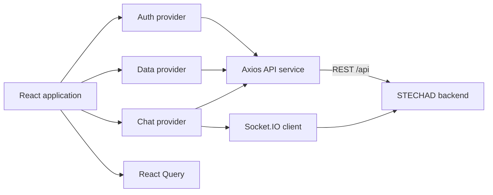

# STECHAD Talent Hub

The STECHAD Talent Hub is the responsive React web application for the STECHAD workforce platform. It provides role-specific experiences for talent, project managers, staff, administrators, and super administrators.

## Table of Contents

- [Capabilities](#capabilities)
- [Technology Stack](#technology-stack)
- [Architecture](#architecture)
- [Prerequisites](#prerequisites)
- [Local Setup](#local-setup)
- [Environment Variables](#environment-variables)
- [Running the Application](#running-the-application)
- [Role-Based Experience](#role-based-experience)
- [Authentication and Sessions](#authentication-and-sessions)
- [Realtime Messaging](#realtime-messaging)
- [API and State Management](#api-and-state-management)
- [Testing](#testing)
- [Building and Previewing](#building-and-previewing)
- [Deployment](#deployment)
- [Project Structure](#project-structure)
- [Development Guidelines](#development-guidelines)
- [Troubleshooting](#troubleshooting)

## Capabilities

- Public landing, talent signup, login, OTP verification, password reset, and invite acceptance
- Google OAuth browser sign-in
- Talent onboarding, job discovery, applications, interviews, projects, and invoices
- Project-manager job publishing, applicant review, interviews, projects, and approvals
- Staff attendance, leave, expenses, holidays, KPIs, profiles, and personal preferences
- Admin talent vetting, project management, users, roles, audit logs, notifications, and workforce operations
- Custom role permissions and delegated management workflows
- Direct and group messaging with search, history, replies, drafts, edits, deletions, presence, and read receipts
- Notifications, analytics, referrals, rewards, exports, and account settings

## Technology Stack

| Area | Technology |
|---|---|
| Framework | React 18 |
| Language | TypeScript and JSX |
| Build tool | Vite 5 |
| Routing | React Router 6 |
| Server state | TanStack React Query |
| HTTP client | Axios |
| Realtime | Socket.IO Client |
| Styling | Tailwind CSS |
| Components | shadcn/ui and Radix UI |
| Forms | React Hook Form |
| Validation | Zod |
| Charts | Recharts |
| Icons | Lucide React |
| Notifications | Sonner and custom toast components |
| Testing | Vitest, Testing Library, and jsdom |

## Architecture

The application is a browser-based single-page application. `App.tsx` composes providers, layouts, protected routes, public routes, and role dashboards.



Route guards enforce authentication and role or permission requirements. Context providers retain session, domain, and chat state while React Query and remote-data hooks coordinate server data.

## Prerequisites

- Node.js 18 or newer
- npm
- A running STECHAD backend
- A modern browser

## Local Setup

1. Enter the frontend directory:

   ```bash
   cd stechad-talent-hub
   ```

2. Install dependencies:

   ```bash
   npm install
   ```

3. Create the frontend environment file:

   ```bash
   touch .env
   ```

4. Configure the backend URL:

   ```env
   VITE_BACKEND_URL=http://localhost:5000/api
   VITE_SOCKET_URL=http://localhost:5000
   ```

5. Start the backend on port `5000`.

6. Start Vite:

   ```bash
   npm run dev
   ```

The default Vite development URL is `http://localhost:8080`.

## Environment Variables

Vite exposes variables prefixed with `VITE_`.

| Variable | Required | Purpose |
|---|---:|---|
| `VITE_BACKEND_URL` | Yes | REST API base, normally `http://localhost:5000/api` |
| `VITE_SOCKET_URL` | Optional | Socket.IO origin when it differs from the REST origin |

`VITE_BACKEND_URL` must include `/api` when the backend is mounted at that path.

Examples:

```env
# Local
VITE_BACKEND_URL=http://localhost:5000/api
VITE_SOCKET_URL=http://localhost:5000

# Production
VITE_BACKEND_URL=https://api.example.com/api
VITE_SOCKET_URL=https://api.example.com
```

Do not store secrets in frontend environment variables. Every `VITE_*` value is shipped to the browser.

## Running the Application

Development server:

```bash
npm run dev
```

Lint the source:

```bash
npm run lint
```

Run tests once:

```bash
npm test
```

## Role-Based Experience

### Public

- Landing page
- Talent registration
- Login and logout
- OTP verification
- Forgot/reset password
- Invite acceptance
- Google OAuth callback
- Talent onboarding

### Talent

- Dashboard and account overview
- Job search and details
- Application tracking
- Interviews
- Assigned projects
- Invoices
- Profile
- Messages

### Project Manager

- Dashboard
- Job creation and management
- Applicants and applications
- Interviews
- Projects and project invoices
- Workforce attendance, leave, expenses, KPIs, and holidays
- Approval workflows
- Profile and messages

### Staff

- Dashboard
- Attendance
- Leave requests
- Expenses
- Holidays
- KPIs
- Profile
- Messages

### Admin and Super Admin

- Platform dashboard
- Talent vetting and talent management
- Project managers and projects
- Users and user attendance
- Custom roles
- Workforce management
- Jobs and applications
- Audit logs
- Notifications
- Settings
- Messages

Custom employee roles can be granted one or more database-backed workforce permissions. The frontend permission helpers normalize and evaluate these permissions for route and control visibility.

## Authentication and Sessions

The `AuthProvider` checks the stored access token on startup with `GET /auth/me`.

- Access and refresh tokens are stored in `localStorage`.
- Axios attaches the access token to authenticated requests.
- Axios refreshes the access token after a `401` response where appropriate.
- Public authentication endpoints bypass automatic retry behavior.
- Revoked or expired sessions clear locally stored credentials and redirect to login.
- Email addresses are normalized to lowercase before authentication requests.
- Password forms match the backend minimum of six characters and provide live confirmation feedback.

The main local-storage keys are:

- `stechad_token`
- `stechad_refresh_token`
- `stechad_user`

Logout clears chat state and authentication state before removing the stored credentials.

## Realtime Messaging

The shared chat module is available to Admin, Project Manager, Talent, and Staff experiences.

Features include:

- Direct and group conversations
- Unread filters and message search
- Older-history pagination
- Replies
- Editing and deleting messages
- Read receipts
- Typing indicators
- Online presence
- Message drafts retained while switching conversations
- Failed-send retry actions
- UUID-based send deduplication

The chat REST client sends messages and conversation actions. Socket.IO supplies live updates. If realtime reconnects, visible conversations refresh periodically.

Set `VITE_BACKEND_URL` to the API base. Socket.IO derives its origin from that URL unless `VITE_SOCKET_URL` is provided. Production should use HTTPS and the corresponding secure WebSocket connection.

To perform a manual chat check:

1. Run the backend and frontend.
2. Sign in as two users in separate browser profiles.
3. Open Messages for both users.
4. Verify delivery and read receipts.
5. Test replies, edits, deletion, group conversations, reconnect behavior, and mobile navigation.

## API and State Management

### API service

`src/services/apiService.js` is the shared Axios client. It provides:

- Shared base URL
- Bearer-token injection
- FormData handling
- Parameter cleanup
- Access-token refresh
- Network and HTTP error normalization
- 429 and `401` handling

Domain services and context providers consume this client. API calls return the normalized backend response to the application.

### Context and hooks

Important state providers include:

- `useAuthContext` — identity, login, logout, and profile updates
- `useDataContext` — shared application data
- `ChatContext` — conversations, messages, presence, typing, drafts, and retry state
- `JobsContext`
- `ApplicationsContext`
- `TalentsContext`
- `ProjectManagersContext`
- `ProjectsContext`
- `NotificationsContext`
- `ReferralsContext`

Server state is also coordinated through TanStack React Query and remote-data hooks.

### UI system

Shared primitives live in `src/components/ui/`. Role pages and feature components compose these primitives with Tailwind utility classes. The `@` alias resolves to `src/`.

## Testing

Run the Vitest suite:

```bash
npm test
```

The test suite uses jsdom and Testing Library. Existing tests cover areas including protected routes, account settings, role permissions, workforce management, notifications, chat alerts, and selected dashboard workflows.

Account-settings regressions keep automatic clock-out hidden, including when a staff account already has that preference enabled. Notification sounds, location privacy, and password changes remain covered through the rendered page. Run this coverage alone with `npm test -- src/pages/AccountSettings.test.tsx`.

For the companion `stechad-backend` suite, install its dependencies and provision a disposable local PostgreSQL database in an isolated test cluster. The test database role must be able to create and drop schemas and tables. Never point test URLs at the application database. From the backend repository, set all three URLs before running:

```bash
AUTH_TEST_DATABASE_URL=postgresql://localhost/stechad_test \
WORKFORCE_TEST_DATABASE_URL=postgresql://localhost/stechad_test \
CHAT_TEST_DATABASE_URL=postgresql://localhost/stechad_test \
npm test
```

These variables enable the authentication, workforce, chat, and associated migration integration suites. They create temporary schemas and use local HTTP/Socket.IO listeners, so the environment must permit loopback connections and listening on ephemeral ports. Without these URLs, database suites report skips even when `npm test` exits successfully; that result does not establish database regression coverage.

Run a production build as an additional verification:

```bash
npm run build
```

## Building and Previewing

Build:

```bash
npm run build
```

The production output is written to `dist/`.

Build the development mode bundle:

```bash
npm run build:dev
```

Preview the built application locally:

```bash
npm run preview
```

Vite's preview command generally serves the last build at `http://localhost:4173`.

## Deployment

1. Set production environment variables.
2. Install dependencies.
3. Run lint and tests.
4. Build the application:

   ```bash
   npm run build
   ```

5. Deploy `dist/` to a static host or Vite-compatible platform.
6. Configure SPA fallback routing so unknown application routes return `index.html`.

Example production variables:

```env
VITE_BACKEND_URL=https://api.example.com/api
VITE_SOCKET_URL=https://api.example.com
```

The repository includes `vercel.json` for platform configuration. Confirm host routing and HTTPS before deployment.

Use HTTPS for the backend, frontend, and Socket.IO endpoints. Restrict backend CORS to the deployed frontend origin.

## Project Structure

```text
stechad-talent-hub/
├── public/                 # Static public assets
├── src/
│   ├── App.tsx             # Providers and route declarations
│   ├── main.tsx            # React entry point
│   ├── components/         # Shared and feature components
│   │   ├── chat/           # Chat-specific UI
│   │   └── ui/             # shadcn/Radix primitives
│   ├── hooks/
│   │   └── contexts/       # Domain and chat providers
│   ├── layouts/            # Public and dashboard layouts
│   ├── lib/                # Permissions and client utilities
│   ├── pages/              # Public and role dashboards
│   ├── services/           # REST, chat, export, and Socket.IO clients
│   ├── types/              # Shared TypeScript types
│   └── utils/              # Browser utilities
├── API_ENDPOINTS.md        # API integration notes
├── vite.config.ts          # Vite server and alias configuration
├── tailwind.config.ts      # Tailwind configuration
└── vitest.config.ts        # Test configuration
```

## Development Guidelines

- Keep API base URL configuration in environment variables.
- Reuse `apiService` and existing context providers rather than creating separate Axios clients.
- Keep password policy and auth validation aligned with `stechad-backend/utils/passwordPolicy.js`.
- Use existing shadcn/Radix components and Tailwind patterns.
- Preserve route protection and permission checks for new role-specific pages.
- Normalize emails before authentication requests.
- Preserve message UUIDs and chat state when adding send/retry behavior.
- Use TypeScript for new modules where practical; avoid unsafe casts.
- Update [API_ENDPOINTS.md](API_ENDPOINTS.md) for meaningful API integration changes.

## Troubleshooting

### API requests fail with CORS errors

- Confirm `VITE_BACKEND_URL`.
- Confirm the backend's `FRONTEND_URL` or `FRONTEND_PROD_URL` includes the current frontend origin.
- Ensure protocol and port match exactly.

### Login works but requests redirect to login

- Inspect `stechad_token` and `stechad_refresh_token`.
- Confirm `JWT_SECRET` and `JWT_REFRESH_SECRET` on the backend.
- Confirm backend clock and session validity.

### Socket.IO does not connect

- Set `VITE_SOCKET_URL` to the backend origin.
- Use `https://` and `wss://` behavior through HTTPS in production.
- Confirm the access token is present.

### Build fails

- Confirm Node.js and npm versions.
- Reinstall the locked dependency set if dependency state is inconsistent:

  ```bash
  npm ci
  npm run build
  ```

- Resolve ESLint and TypeScript diagnostics before deployment.

### Refresh does not preserve authentication

- Confirm `stechad_token` is present.
- Confirm `/auth/me` is reachable through `VITE_BACKEND_URL`.
- Confirm the backend account is active and the token session version is valid.
